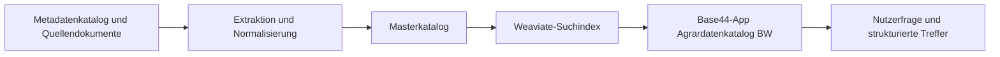

# DaVe Abschlussbericht - digitale Artefakte und Agrardatenkatalog BW

Dieses Repository ergaenzt den Abschlussbericht des Projekts **DaVe** um ausgewaehlte digitale Artefakte.

Es enthaelt bewusst nur die wichtigsten Dateien fuer Nachvollziehbarkeit, Anschlussfaehigkeit und spaetere Weiterentwicklung. Arbeitskopien, Roh-PDFs, API-Keys und grosse Zwischenstaende sind nicht enthalten.

## Inhalt

Dieses Repository umfasst vier zentrale Bestandteile:

- `bpmn/`: BPMN-2.0-Prozessdiagramm des DaVe-Kontexts
- `data/`: Excel- und CSV-Kataloge zu Anforderungen, Datenerhebungen und Quellendokumenten
- `docs/`: Architektur, Textbaustein fuer den Abschlussbericht und fachliche Einordnung
- `scripts/`: zentrale Python-Skripte fuer Extraktion, Katalogaufbau und Weaviate-Anbindung

Zusaetzlich enthaelt `app_base44/` die Dokumentation zur Base44-App **Agrardatenkatalog BW**.

## Agrardatenkatalog BW

Der Prototyp erschliesst Agrarstandards, Fachrecht, Foerderrichtlinien und weitere Grundlagendokumente. Fliesstexte werden in atomare Anforderungen zerlegt und mit Quelle, Fundstelle und Originaltext verbunden.

Ziel ist eine nutzerfreundliche Suche, bei der Fragen wie diese gestellt werden koennen:

> Was muss ich im Bioland-Hopfenanbau zum Abstand zu konventionellen Hopfengaerten beachten?

Die App sucht dann in einem Weaviate-basierten Katalog und zeigt passende atomare Anforderungen mit Quelle, Fundstelle und weiteren Detailinformationen an.

## Aktueller Prototypstand

- Atomare Anforderungen: 878
- Datenerhebungen: 70
- Quellendokumente: 46
- Weaviate-Objekte insgesamt: 994
- Weaviate-Collection: `AtomicRequirement`

Enthaltene groessere Standards im Prototyp:

- `Bioland (Bioland-Richtlinien)`: 554 automatisch extrahierte Rohanforderungen
- `ECOVIN (ECOVIN-Richtlinie, 18. Fassung, gueltig ab 29.04.2025)`: 44 automatisch extrahierte Rohanforderungen

Weitere Anforderungen stammen unter anderem aus DueV, Pflanzenschutzrecht, GAP-bezogenen Dokumenten und weinrechtlichen Dokumenten.

## Systemueberblick

## Wichtige Dateien

### BPMN

- `bpmn/dave_gesamt.bpmn`: BPMN-2.0-Prozessmodell

### Daten

- `data/excel/master_catalog.xlsx`: konsolidierter Anforderungskatalog
- `data/excel/data_collections.xlsx`: Katalog der Datenerhebungen
- `data/excel/DaVe_AP_2_Metadatenkatalog_urls_formats_bereinigt.xlsx`: bereinigter AP-2-Metadatenkatalog
- `data/excel/base44_import_tables.xlsx`: Tabellen fuer eine moegliche Base44-Datenuebernahme
- `data/csv/atomic_requirements_master.csv`: atomare Anforderungen als CSV
- `data/csv/data_collections.csv`: Datenerhebungen als CSV
- `data/csv/source_documents.csv`: Quellendokumente als CSV

### Dokumentation

- `docs/ARCHITEKTUR.md`: technische und fachliche Architektur
- `docs/ABSCHLUSSBERICHT_TEXTBAUSTEIN.md`: Textbaustein fuer den Abschlussbericht
- `weaviate/WEAVIATE_ANBINDUNG.md`: Hinweise zur Weaviate-Anbindung
- `app_base44/BASE44_APP_UND_MIGRATION.md`: Einordnung der Base44-App und Migrationsoptionen

### Skripte

Die Skripte in `scripts/` dokumentieren den Kern der lokalen Pipeline:

- Import ausgewaehlter Standards
- Aufbau des Masterkatalogs
- Export fuer Weaviate
- Upload und Suche in Weaviate

## Was nicht enthalten ist

Nicht enthalten sind:

- echte API-Keys
- `.env`-Dateien
- urheberrechtlich geschuetzte Original-PDFs
- grosse Zwischenordner aus der lokalen Verarbeitung
- vollstaendiger Base44-Quellcode

Die Datei `.env.example` enthaelt nur Platzhalter.

## Hinweis zur Base44-App

Die App **Agrardatenkatalog BW** wurde in Base44 erstellt. Base44 speichert die App-Struktur nicht automatisch wie ein klassisches lokales React- oder Node-Projekt im Dateisystem. Deshalb liegt hier vor allem die fachliche und technische Dokumentation der App vor.

Eine vollstaendige Migration zu GitHub ist grundsaetzlich moeglich, wuerde aber bedeuten, die App als eigenstaendige Web-App neu aufzusetzen oder aus Base44 exportierbare Teile manuell zu uebertragen.

## Qualitaetshinweis

Die Extraktion aus Bioland und ECOVIN ist ein prototypischer, regelbasierter Rohimport. Die Ergebnisse sind fuer Demonstration, Forschung und Weiterentwicklung geeignet, aber noch nicht vollstaendig fachlich validiert.

Die Anwendung ersetzt keine Rechtsberatung. Ergebnisse sollten fachlich geprueft werden, bevor sie fuer verbindliche Entscheidungen genutzt werden.
