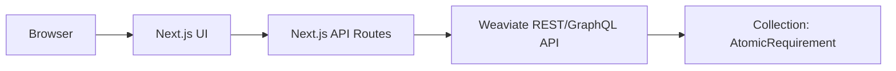

# Agrardatenkatalog BW App

Eigenstaendige Web-App fuer die Suche in atomaren Anforderungen des **Agrardatenkatalog BW**.

Die App ist als Nachbau des Base44-Prototyps gedacht. Sie nutzt Weaviate als Suchspeicher und kann als eigenes GitHub-Repository gepflegt werden.

## Funktionen

- Suche nach atomaren Anforderungen in natuerlicher Sprache
- Auswahl einzelner Quellendokumente
- strukturierte Trefferliste mit Quelle, Fundstelle und Anforderungstext
- Detailansicht mit Akteur, Handlung, Objekt, Bedingung, Frist, Nachweis und Originalzitat
- Quellendokumente-Uebersicht
- serverseitige Weaviate-Anbindung, damit der API-Key nicht im Browser sichtbar ist

## Architektur



## Lokale Einrichtung

```bash
npm install
cp .env.example .env.local
npm run dev
```

Danach `.env.local` ausfuellen:

```env
WEAVIATE_URL="https://dein-cluster.weaviate.cloud"
WEAVIATE_API_KEY="dein-weaviate-api-key"
WEAVIATE_COLLECTION="AtomicRequirement"
```

Die App laeuft lokal unter:

```text
http://localhost:3000
```

## Deployment

Am einfachsten ist ein Deployment ueber Vercel:

1. GitHub-Repository mit Vercel verbinden
2. Environment Variables setzen:
   - `WEAVIATE_URL`
   - `WEAVIATE_API_KEY`
   - `WEAVIATE_COLLECTION`
3. Deploy ausfuehren

## Hinweis zu Weaviate

Die App funktioniert nur solange, wie der Weaviate-Cluster erreichbar ist und der API-Key gueltig ist. Wenn die Weaviate-Lizenz oder der Cluster spaeter deaktiviert wird, bleiben Code und Dokumentation erhalten, aber die Live-Suche funktioniert nicht mehr.

Fuer eine dauerhafte Loesung waere spaeter eine dieser Varianten sinnvoll:

- eigener langfristiger Weaviate-Cluster
- Export der Daten in eine relationale Datenbank plus Volltextsuche
- OpenSearch/Elasticsearch
- lokale statische Suche fuer kleinere Datenbestaende

## Sicherheit

Nicht ins Repository hochladen:

- `.env`
- `.env.local`
- echte API-Keys
- private Zugangsdaten

Der Weaviate-Key wird nur serverseitig in den API-Routen genutzt.
